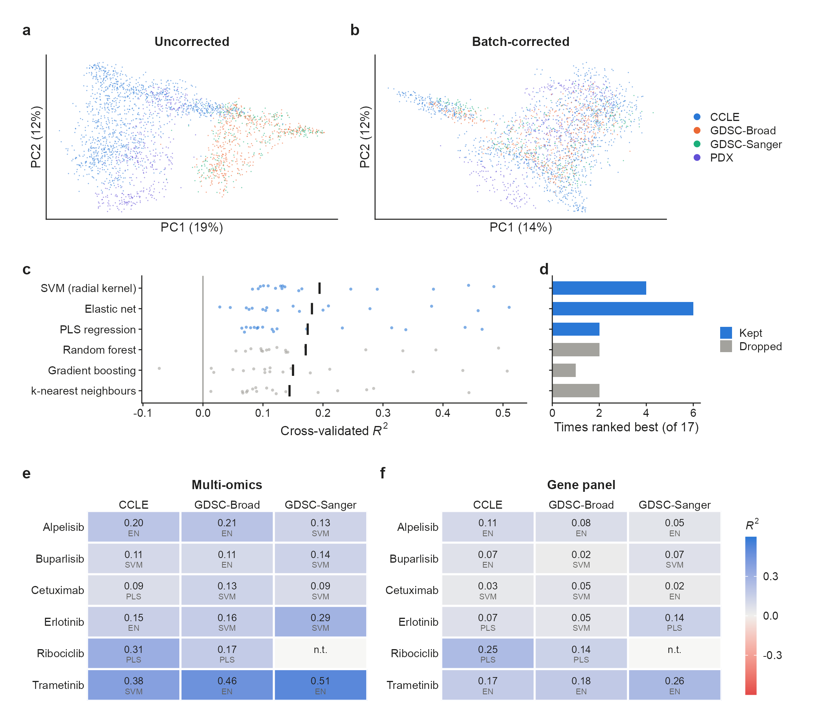
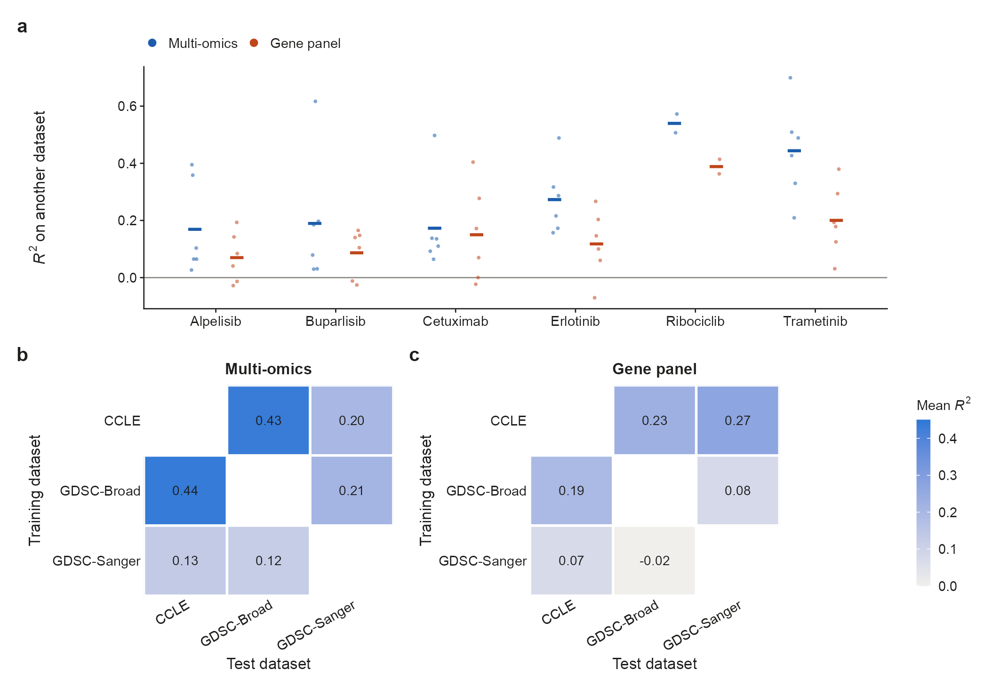
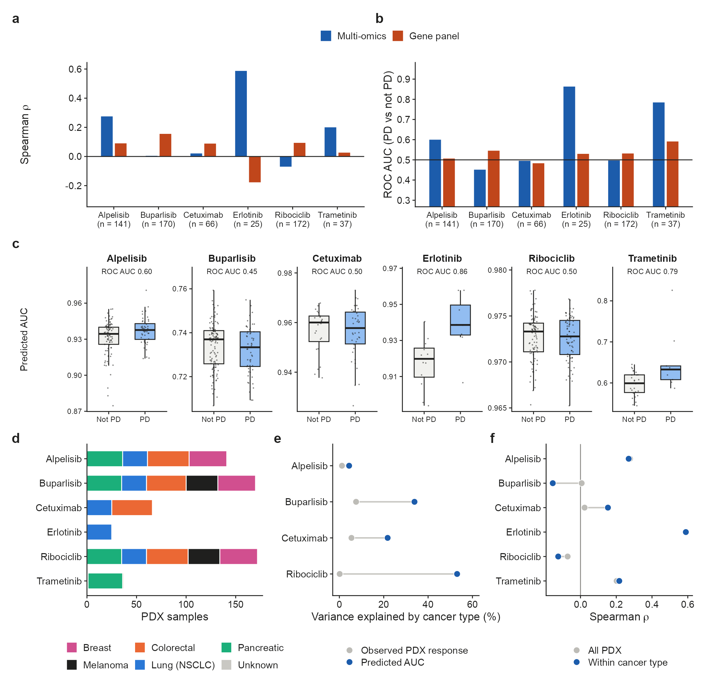
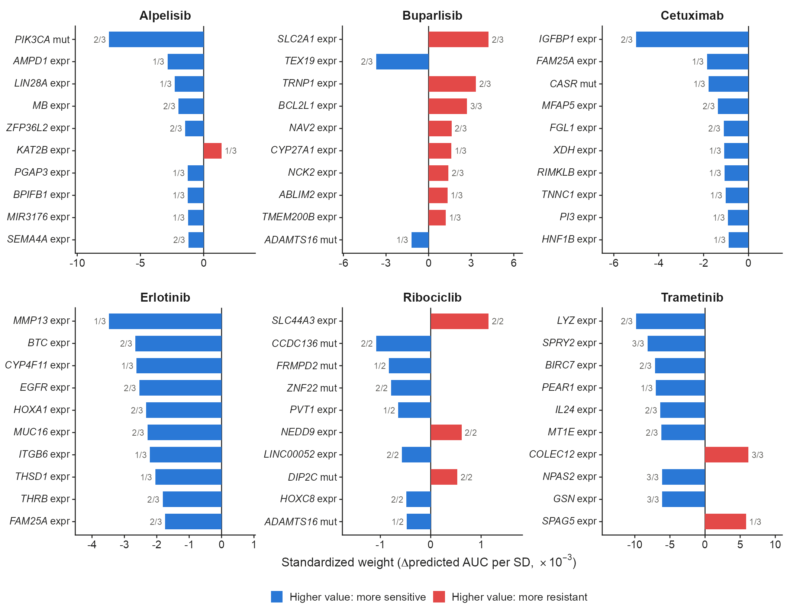
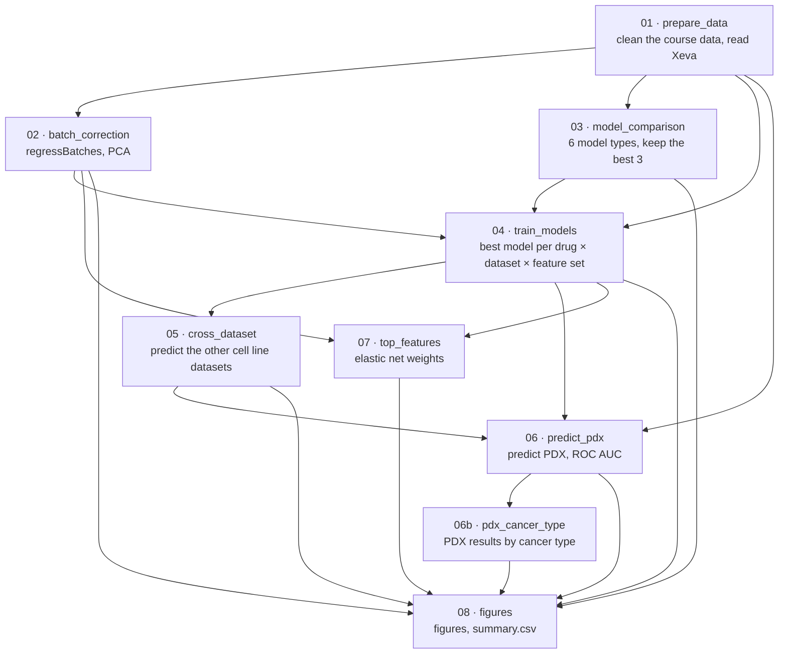

# Cancer drug response prediction from multi-omics data

Can drug response measured in cancer cell lines predict how real tumours respond?
This project trains machine-learning models on three cell line drug screens and tests them on
patient-derived xenografts (PDX: human tumours grown in mice), for six targeted cancer drugs.

The datasets differ systematically (batch effect), so they are batch-corrected first. Two feature
sets are compared: full multi-omics (expression, copy number, and mutations of ~18,000 genes) and a
clinical-style **gene panel** (copy number and mutations of 882 cancer genes, no expression).

PDX is used only as a test set: no model, setting or ensemble is trained or chosen on it. The
whole analysis is a Snakemake pipeline (see Pipeline and How to run).

This is the capstone project of the computational genomics workshop *A Hands-on Course on Machine
Learning for Genomics*, held by the Berlin Institute for Medical Systems Biology, Max Delbrück
Center, Berlin, Germany, in 2021.

## Data

The course data can be downloaded as one
[archive](https://bimsbstatic.mdc-berlin.de/akalin/AAkalin_DrugResponse/prepared/AAkalin_DrugResponse-prepared.tar.gz).
Everything is in `data/raw/` (not in git).

| Dataset (folder in `data/raw/`) | What it is | Samples (multi-omics) | Used for |
|---|---|---|---|
| **CCLE** (`CCLE/`) | Cancer Cell Line Encyclopedia: a large panel of cancer cell lines, molecularly profiled and drug-screened at the Broad Institute | 1,291 (1,722 with panel data) | training / testing |
| **GDSC-Broad** (`GDSC_broad/`) | Genomics of Drug Sensitivity in Cancer (Sanger Institute) drug screens, for the cell lines whose omics come from the Broad Institute. The cell lines are all in CCLE too, with separately processed omics and nearly the same drug responses (r = 0.96–1.00 for five drugs) | 507 | training / testing |
| **GDSC-Sanger** (`GDSC_sanger/`) | GDSC drug screens for the cell lines profiled at the Sanger Institute; no overlap with GDSC-Broad, 54 cell lines also in CCLE | 281 | training / testing |
| **PDX** (`PDX_all/`) | Patient-derived xenografts from the Novartis PDX Encyclopedia (Gao et al., *Nat Med* 2015): pieces of patient tumours grown and treated in mice. Each **PDX sample** is the tumour of one patient, grown in mice (Xeva calls it a "model"); each drug was tested on one mouse per sample. Closer to real tumours than cell lines grown in culture | 399 PDX samples | **testing only** |
| **Xeva** (`xeva/`) | `Xeva_PDXE_tsv.tar.gz`: the same PDX data curated with the Bioconductor package [Xeva](https://bioconductor.org/packages/Xeva/) (ORCESTRA, [Zenodo record 19354439](https://zenodo.org/records/19354439)), with tumour volume curves, response classes and the cancer type of each sample | same 399 PDX samples | PDX response classes and cancer types (Figure 3) |
| Gene lists (`auxiliary/`) | `all_intersect_genes.tsv` (18,355 genes shared by all datasets), `oncoKB_intersect_genes.tsv` (the 882 panel genes), `oncoKB_gene_list.tsv` (all 1,064 OncoKB genes with IDs) | – | not used: the omics files are already limited to these genes |

Each dataset folder has `all_intersect_genes/` (expression, copy number and mutations of the
~18,000 shared genes), `oncoKB_intersect_genes/` (copy number and mutations of the 882 OncoKB
cancer genes: the gene panel) and `drug_response/`.

Drugs: Alpelisib, Buparlisib (PI3K), Cetuximab, Erlotinib (EGFR), Ribociclib (CDK4/6), Trametinib (MEK).

**Response measures.**
- **Cell lines: AUC**, the area under the dose-response curve; lower = more sensitive. The models predict this value.
- **PDX: change in tumour volume** under the drug. It is on a different scale from the cell line AUC, so PDX predictions are judged by ranking only.
- **PDX: mRECIST class**, taken from Xeva, which assigns it from each tumour's volume curve: CR /
  PR (tumour shrank), SD (stable) or **PD (progressive disease: the tumour kept growing)**.
  Shrinking tumours are rare (3–12 per drug), so the tumours are split into PD vs not PD.

**Xeva.** `Xeva_PDXE_tsv.tar.gz` holds Xeva's tables as TSV files. `01_prepare_data.R` extracts two
of them to a temporary folder (the archive itself is left as is): `model.tsv` (PDX sample → patient,
drug and cancer type) and `sensitivity_model.tsv` (response per PDX sample).
`06b_pdx_cancer_type.R` reads the cancer types from `model.tsv` the same way. It saves the mRECIST class, best response, best
average response, slope and AUC of the growth curve (`data/processed/PDX_xeva_response.rds`).
They show that the course PDX value is Xeva's best % change in tumour volume, rescaled (Spearman
0.93–0.99), and they give the mRECIST classes. Xeva also has its own PDX omics, including
continuous copy numbers. The course PDX copy numbers are almost all neutral (~1% gains or losses,
vs 40–55% in cell lines). Rebuilding them from Xeva did not improve PDX prediction, so the models
use only the course omics.

## Main results

| | Multi-omics | Gene panel |
|---|---|---|
| Cross-validation R², mean of best models | **0.21** | 0.10 |
| R² on another cell line dataset, mean | **0.27** | 0.14 |
| PDX: Spearman with response (ensemble, mean over drugs) | **0.17** | 0.05 |
| PDX: ROC AUC, PD vs not PD (ensemble, mean over drugs) | **0.62** | 0.53 |

**ROC AUC** (area under the receiver operating characteristic curve) is computed here
(`06_predict_pdx.R`) from our predictions and the Xeva classes. It measures how well the predicted
AUC separates PD tumours from the rest: the probability that a randomly picked PD tumour gets a higher predicted AUC (more resistant) than a
randomly picked tumour that is not PD. 0.5 is chance, 1 is perfect.

1. **Batch correction removes most of the dataset differences** between the cell line datasets
   (Figure 1a, b). The results hardly depend on it (`summary.csv`):
   - Without correction, cross-validation is identical.
   - Transfer between cell line datasets is slightly lower (R² 0.25 vs 0.27).
   - PDX results are unchanged.
2. **Response is partly predictable within a dataset.** Cross-validated R² ranges from ~0.1
   (Buparlisib, Cetuximab) to ~0.5 (Trametinib). SVM, elastic net and PLS did best of six model
   types (Figure 1c–f).
3. **Expression matters.** Without expression (the gene panel), every measure drops:
   - cross-validated R² from 0.21 to 0.10 (Figure 1e vs f);
   - R² on another cell line dataset from 0.27 to 0.14 (Figure 2);
   - PDX ROC AUC from 0.62 to 0.53, close to chance (Figure 3b).
4. **On PDX, the models carry signal for some drugs only.** Tumours that kept growing under
   Erlotinib or Trametinib get clearly higher predicted resistance (ROC AUC 0.86 and 0.79).
   Buparlisib, Cetuximab and Ribociclib are at chance. Erlotinib (25 PDX) and Trametinib (37)
   have few samples, so these numbers are uncertain (Figure 3a–c).
   - Both were tested on one cancer type only (Erlotinib: all lung, Trametinib: pancreatic), so
     the models rank tumours *within* a cancer type rather than telling cancer types apart
     (Figure 3d).
   - For Buparlisib and Ribociclib, cancer type explains much of the predictions (34% and 53% of
     the variance) but almost none of the PDX response (8% and 0.1%). The models carry
     cancer type differences from the cell lines that don't hold in PDX (Figure 3e, f).
5. **The models pick up known biology** (Figure 4):
   - *PIK3CA* mutation predicts sensitivity to the PI3Kα inhibitor Alpelisib.
   - *EGFR* expression and its ligand *BTC* predict sensitivity to Erlotinib.
   - *SPRY2*, a readout of MAPK pathway activity, predicts sensitivity to the MEK inhibitor
     Trametinib.
6. **R² on PDX is always strongly negative (about −9)** because the PDX response is a tumour
   volume change, not a dose-response AUC, so the values sit on a different scale. Correlations
   and ROC AUC are the fair measures there.

## Figures

All results are from batch-corrected data. The exception is the model comparison (Figure 1c, d),
which gives the same result either way. Figure 1a also shows the uncorrected data.



**Figure 1. Batch effect between datasets, model choice and cross-validated performance.**
- (**a**, **b**) First two principal components of gene expression for all 2,478 samples:
  1,291 CCLE, 507 GDSC-Broad and 281 GDSC-Sanger cell lines and 399 PDX tumours. The 2,000 genes
  with the highest variance over all samples are used, scaled, the same in both panels.
  Percentages are the variance explained.
  - (**a**) Uncorrected, the datasets separate, although all GDSC-Broad cell lines are also in
    CCLE.
  - (**b**) After batch correction (`batchelor::regressBatches`, which removes each dataset's own
    mean per gene) the cell line datasets overlap. PDX stays partly apart, which is expected
    biologically: they are tumours grown in mice, while the others are cell lines grown in culture.
- (**c**) Six model types compared by 10-fold cross-validated *R*² (1 − SSE/SST on out-of-fold
  predictions), one point per drug × cell line dataset (17 combinations; Ribociclib in
  GDSC-Sanger has too few samples). Multi-omics features, the same folds for every model.
  Black bars: mean.
  - This comparison was run before batch correction. Within one dataset the correction only
    shifts each feature by a constant, which does not change cross-validation.
  - Kept for all later steps (blue): SVM with radial kernel (0.19), elastic net (0.18) and PLS
    regression (0.17).
  - Dropped (grey): random forest (0.17), gradient boosting (xgboost, 0.15) and k-nearest
    neighbours (0.14).
- (**d**) How often each model type won: for each of the 17 drug × dataset combinations, the
  model type with the highest cross-validated *R*² in panel c is counted once (17 in total).
  Elastic net was best most often (6), although SVM has the highest mean *R*².
- (**e**, **f**) Cross-validated *R*² of the best of the three kept model types per drug and
  dataset, with (**e**) multi-omics features and (**f**) the gene panel.
  - The model type is shown under each value: EN, elastic net; SVM, support vector machine;
    PLS, partial least squares. n.t.: not trained (3 samples).
  - The panel roughly halves performance (mean *R*² 0.21 vs 0.10).



**Figure 2. Transfer of models between cell line datasets.**
- (**a**) *R*² when the best model of one dataset predicts the other two.
  - Points: one train → test pair (up to six per drug, two for Ribociclib; test sets with ≥ 10
    samples only).
  - Bars: mean.
- (**b**, **c**) Mean *R*² over drugs for each training → test pair, with (**b**) multi-omics
  features and (**c**) the gene panel.
  - CCLE and GDSC-Broad share their cell lines and nearly the same drug responses, so transfer
    between them is optimistic.
  - Tests involving GDSC-Sanger are the more independent ones (54 cell lines shared with CCLE).
  - Models trained on GDSC-Sanger, the smallest dataset, transfer worst.



**Figure 3. Prediction of PDX tumour response with models trained on cell lines.**
For each drug, the PDX response is predicted with the ensemble of the best models of the three
cell line datasets. No model, setting or ensemble member was chosen using PDX.
- (**a**) Spearman correlation between predicted cell line AUC and the PDX response (change in
  tumour volume). n: number of PDX samples (one patient's tumour each, see Data) treated with the
  drug and with a measured response.
- (**b**) ROC AUC (area under the receiver operating characteristic curve) for separating
  tumours that kept growing under treatment (mRECIST progressive disease, PD; class from Xeva)
  from the rest, using the predicted AUC. 0.5 is chance, 1 is perfect separation.
  PD / all classified samples: Alpelisib 48/137, Buparlisib 53/164, Cetuximab 38/62,
  Erlotinib 8/20, Ribociclib 71/164, Trametinib 9/36.
- (**c**) Predicted cell line AUC of the multi-omics ensemble for PD and not-PD tumours, with
  the ROC AUC of panel b on top. Boxes: median and interquartile range; points: PDX samples.
- (**d**–**f**) Cancer type of the PDX samples (from Xeva), multi-omics ensemble.
  - (**d**) PDX samples per drug and cancer type. Trametinib: 35 pancreatic, 1 colorectal, 1 not
    in Xeva.
  - (**e**) Share of the variance explained by cancer type in the predicted AUC (blue) and in
    the observed PDX response (grey), for drugs tested on at least two cancer types with ≥ 5
    PDX samples each.
  - (**f**) Spearman correlation over all PDX samples (grey) and within cancer types (blue: each
    cancer type's mean rank removed first).
  - (**e**, **f**) are computed on ranks, since predicted AUC and PDX response are on different
    scales.

The PDX response is a change in tumour volume, not a dose-response AUC, so *R*² is not
meaningful here (about −9 everywhere; see `pdx_metrics.csv`). Only Erlotinib and Trametinib
are clearly above chance, and both have few PDX samples.



**Figure 4. Strongest features of the elastic net models.**
Ten features with the largest mean standardized weight per drug, from the elastic net models
(multi-omics) of each cell line dataset. Elastic net is the one kept model type with
a weight per feature that can be read directly.
- **Standardized weight:** the model coefficient × the feature's standard deviation in the
  training samples, i.e. the change in predicted AUC for a one-SD change in the feature. It is
  averaged over the datasets, with 0 where a model did not select the feature.
- **Colours:** blue, a higher value predicts sensitivity (lower AUC); red, it predicts
  resistance.
- **Numbers:** how many of the drug's models selected the feature. Features selected in every
  dataset are the more reliable markers.
- **Labels:** expr, expression; CNV, copy number; mut, mutation. Gene symbols come from
  org.Hs.eg.db.


## Pipeline

Each box is a rule in the `Snakefile` and runs one script in `scripts/`.



Details:
- **Preparation**: PDX expression is log2(x + 1)-transformed (raw FPKM, unlike the cell lines);
  mutations are encoded as gene-level 0/1 (non-silent); repeated drug measurements are averaged.
- **Batch correction**: `batchelor::regressBatches` per omic and feature set removes each
  dataset's own mean per feature. It uses the PDX omics, never the PDX responses. It also corrects each dataset with its own samples only, so new data can be corrected the same way without retraining.
- **Features**, chosen on the training samples only: top 5000 most variable expression genes, top
  5000 most variable CNV genes, genes mutated in ≥ 5% of samples. Gene panel: all CNV genes and
  mutations down to 1% (curated cancer genes, e.g. EGFR mutations for Erlotinib).
- **Training**: one model per drug × cell line dataset × feature set, 10-fold CV, best of the 3
  kept model types. The models are also trained on uncorrected data, for the comparison in
  `summary.csv`.
- **R²** is 1 − SSE/SST on out-of-fold predictions (not caret's squared correlation), so it can be negative.
- **Single best model** per drug: of the best model of each cell line dataset, the one with the
  highest R² on the other cell line datasets. **Ensemble**: average of those models, leaving out
  any with CV R² ≤ 0.
- **PDX evaluation**: R², Pearson and Spearman against the PDX response, and ROC AUC for PD vs not
  PD (see Data).
- Models with fewer than 20 training samples are skipped, test sets with fewer than 10 too.

## How to run

Needs R 4.5 and Snakemake (≥ 8), with these R packages:
- **CRAN:** data.table, caret, glmnet, kernlab, pls, ranger, xgboost, doParallel, ggplot2,
  patchwork, ragg.
- **Bioconductor:** batchelor, BiocNeighbors, SummarizedExperiment, AnnotationDbi, org.Hs.eg.db.

1. Put the course data in `data/raw/` (`CCLE/`, `GDSC_broad/`, `GDSC_sanger/`, `PDX_all/`) and
   `Xeva_PDXE_tsv.tar.gz` in `data/raw/xeva/`.
2. From the project root, with R and Snakemake on the PATH:
   ```
   snakemake -n            # show what would run
   snakemake --cores <n_core>    # run everything that is missing or out of date
   ```

## Limitations
- Cell line AUC and PDX tumour response measure different things, so PDX results are judged on
  ranking only.
- PDX sample sizes are small for Erlotinib and Trametinib, and responders (shrinking tumours) are
  rare for every drug (3–12 per drug), so PD vs not PD is used instead.
- The feature filter is fitted once per training set, not inside each CV fold, and the best model
  type is chosen by CV R²; both make CV R² slightly optimistic. Cross-dataset and PDX results are not affected.
- The top features come from one linear model type and show association, not causation.

## Author
Mehdi Esmaeili-Fard (mehdi.esmaeilifard@gmail.com).  
Completion date: September 2021.